[README.md](https://github.com/user-attachments/files/34869617/README.md)
# Customer Churn Prediction System

A machine learning project that analyzes telecom customer data,
identifies patterns associated with customer churn, and predicts whether
a customer is likely to leave. The project covers exploratory data
analysis (EDA), feature engineering, baseline evaluation, model
comparison, error analysis, and SHAP-based model explainability.

> **Dataset:** IBM Telco Customer Churn\
> **Records:** 7,043 customers\
> **Final model selected:** Logistic Regression\
> **Primary selection metric:** Churn-class recall (0.759)

------------------------------------------------------------------------

## Table of Contents

-   [Project Overview](#project-overview)
-   [Business Problem](#business-problem)
-   [Dataset](#dataset)
-   [Exploratory Data Analysis](#exploratory-data-analysis)
-   [Feature Engineering](#feature-engineering)
-   [Baseline Models](#baseline-models)
-   [Model Training and Comparison](#model-training-and-comparison)
-   [Confusion Matrix and Error
    Analysis](#confusion-matrix-and-error-analysis)
-   [Model Explainability with SHAP](#model-explainability-with-shap)
-   [Technology Stack](#technology-stack)
-   [Project Structure](#project-structure)
-   [Installation and Usage](#installation-and-usage)
-   [Results Summary](#results-summary)
-   [Limitations](#limitations)
-   [Future Improvements](#future-improvements)
-   [Author](#author)

------------------------------------------------------------------------

## Project Overview

Customer churn is a major concern for subscription-based businesses.
Losing customers can affect recurring revenue and increase the effort
required to acquire replacements. This project uses the IBM Telco
Customer Churn dataset to study customer behaviour and build
classification models that identify customers who have churned or are
likely to be classified as churners based on the available customer
attributes.

The workflow includes:

-   Inspecting and cleaning the raw customer dataset.
-   Exploring churn distribution and relationships between customer
    attributes and churn.
-   Creating seven additional features.
-   Establishing simple baseline models.
-   Training and comparing Logistic Regression, Random Forest, and
    XGBoost.
-   Evaluating model performance using accuracy, precision, recall,
    F1-score, and ROC-AUC.
-   Investigating false positives and false negatives.
-   Applying SHAP to interpret feature importance.

**Scope note:** The supplied dataset contains historical churn labels.
The current project is a churn-classification workflow; it does not
demonstrate a time-aware prediction made exactly 30 days before a
customer cancels.

## Business Problem

A business needs to understand which customers are more likely to leave
so that retention teams can investigate customer experience and consider
appropriate actions.

The project focuses particularly on **recall for the churn class**. A
false negative means that a customer who actually churned was classified
as a customer who stayed. In a retention scenario, these missed churners
may represent customers the business failed to identify.

The model is intended as an analytical decision-support experiment, not
as an automated customer-treatment system.

## Dataset

-   **Dataset:** IBM Telco Customer Churn
-   **Number of records:** 7,043
-   **Target column:** `Churn`
-   **Target values:** `Yes` and `No`

### Churn distribution

  Customer status     Number of customers   Percentage
  ----------------- --------------------- ------------
  Stayed (`No`)                     5,174        73.5%
  Churned (`Yes`)                   1,869        26.5%
  **Total**                     **7,043**     **100%**

The target classes are imbalanced: approximately 26.5% of the records
belong to the churn class. For this reason, accuracy alone is not
sufficient to assess model performance.

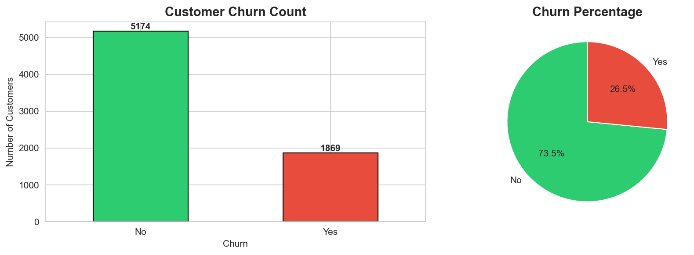

## Exploratory Data Analysis

EDA was performed to understand the dataset, identify patterns, and
investigate how customer attributes relate to churn.

### 1. Contract type

  Contract type      Churn rate
  ---------------- ------------
  Month-to-month          42.7%
  One year                11.3%
  Two year                 2.8%

Customers on month-to-month contracts show a substantially higher churn
rate than customers on longer-term contracts.

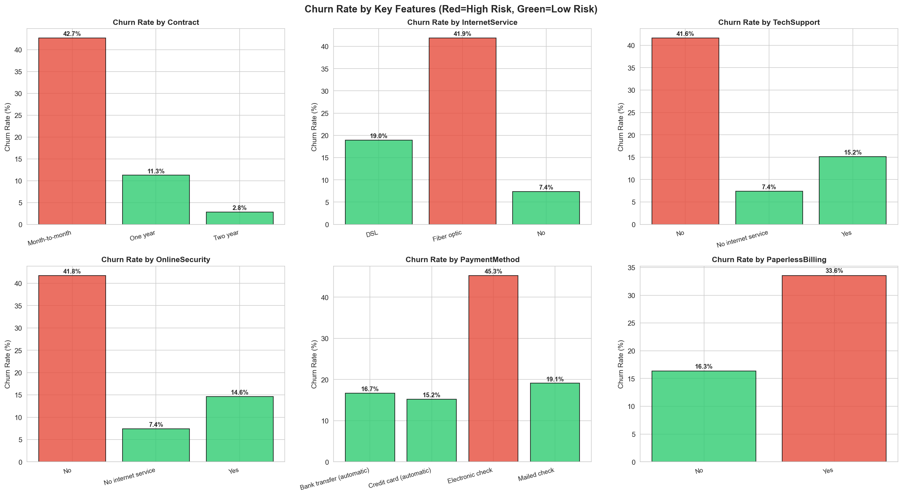

### 2. Tenure and new customers

The analysis shows a strong relationship between customer tenure and
churn:

  Customer group                             Churn rate
  ---------------------------------------- ------------
  New customers (tenure ≤ 6 months)               52.9%
  Not new customers (tenure \> 6 months)          19.5%

The tenure comparison also shows that churned customers generally have
shorter customer relationships than customers who stayed.

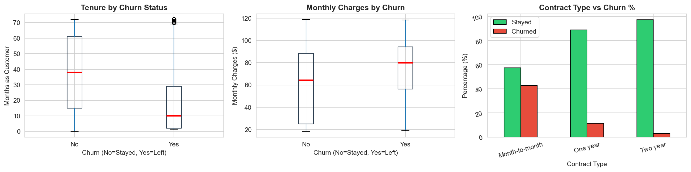

### 3. Internet and support services

Selected churn rates from the category analysis:

  Feature            Category                Churn rate
  ------------------ --------------------- ------------
  Internet service   DSL                          19.0%
  Internet service   Fiber optic                  41.9%
  Internet service   No internet service           7.4%
  Tech support       No                           41.6%
  Tech support       Yes                          15.2%
  Online security    No                           41.8%
  Online security    Yes                          14.6%

The observed churn rates differ across internet-service and
support-service groups. These are associations in this dataset and
should not be interpreted as proof of causation.

### 4. Monthly charges

The charge-group analysis reports the following churn rates:

  Monthly charge group     Churn rate
  ---------------------- ------------
  \$0--\$30                      9.8%
  \$30--\$50                    30.8%
  \$50--\$70                    20.8%
  \$70--\$90                    37.8%
  \$90+                         32.8%

The distribution chart also compares monthly charges for customers who
stayed and customers who churned.

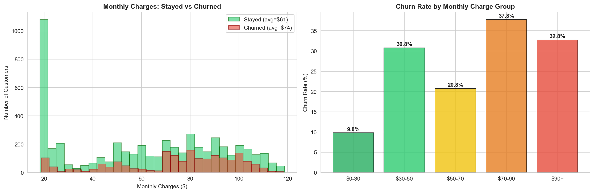

### 5. Other categorical patterns

The EDA notebooks also examine payment method and paperless billing. In
the supplied category chart, electronic-check customers have a churn
rate of 45.3%, while paperless-billing customers have a churn rate of
33.6%, compared with 16.3% for customers without paperless billing.

### 6. Numerical distributions and correlation

The numerical analysis examines tenure, monthly charges, and total
charges. A correlation heatmap is also used to inspect relationships
among selected numerical variables and the churn indicator.

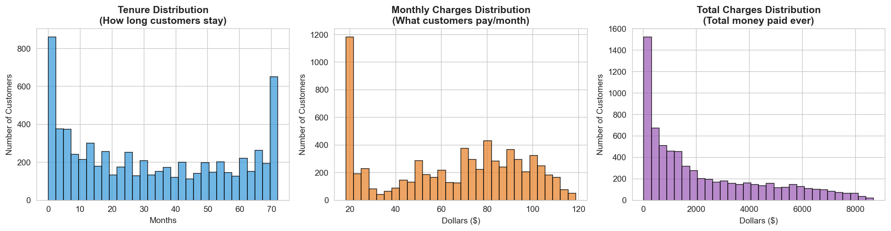

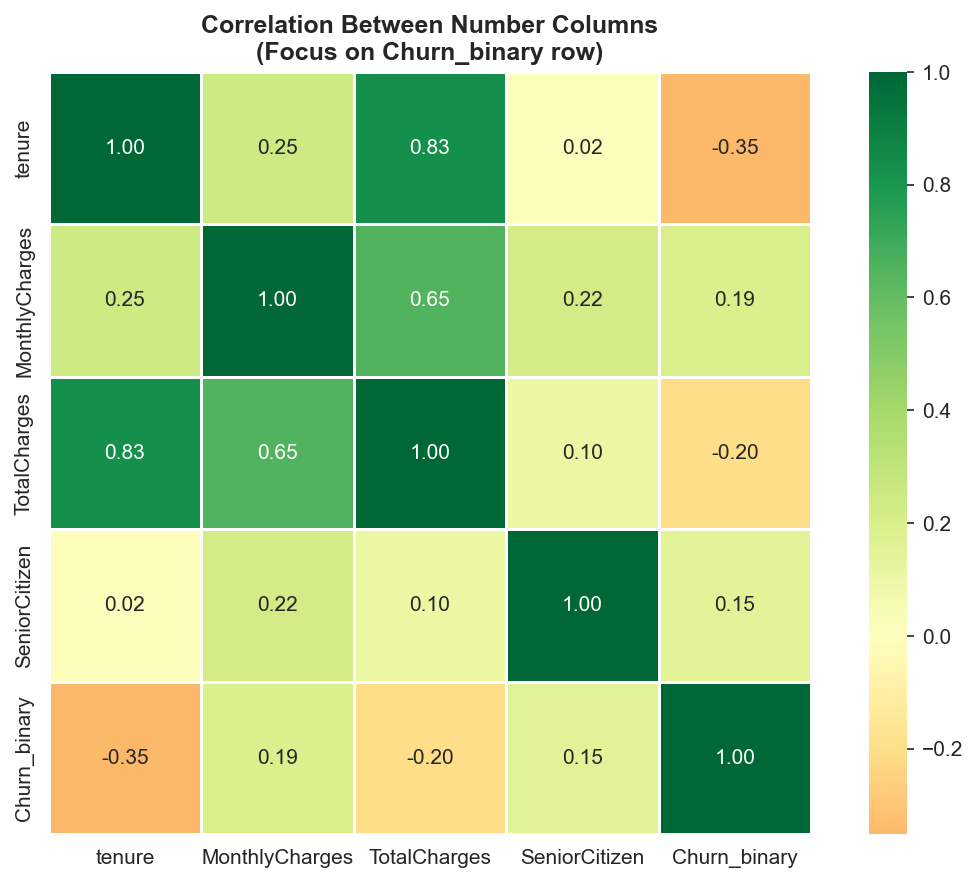

## Feature Engineering

Seven additional features were created to represent customer tenure,
service usage, charges, and contract-related risk.

  -----------------------------------------------------------------------
  Engineered feature                  Description
  ----------------------------------- -----------------------------------
  `is_new_customer`                   Indicates whether customer tenure
                                      is 6 months or less

  `is_loyal_customer`                 Indicates whether customer tenure
                                      is at least 24 months

  `charges_per_month`                 Derived from
                                      `TotalCharges / (tenure + 1)`

  `num_services`                      Counts selected services marked as
                                      `Yes`

  `has_support`                       Indicates whether the customer has
                                      TechSupport or OnlineSecurity

  `is_high_value`                     Indicates whether `MonthlyCharges`
                                      is greater than 70

  `contract_risk`                     Encodes month-to-month as 2,
                                      one-year as 1, and two-year as 0
  -----------------------------------------------------------------------

The new-feature validation chart compares churn rates across selected
engineered features.

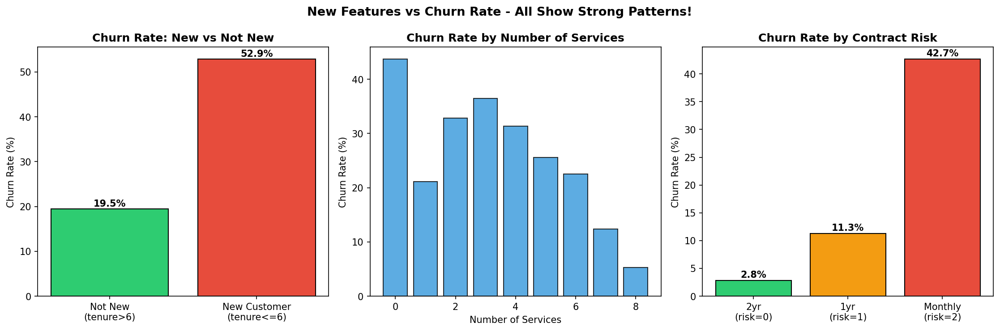

## Baseline Models

Before comparing the final machine learning models, baseline approaches
were evaluated to establish reference performance.

The supplied baseline comparison chart shows:

  Baseline approach                Accuracy   Precision   Recall   F1-score
  ------------------------------ ---------- ----------- -------- ----------
  Always predict No                   0.735         ---    0.000        ---
  Simple Rule                         0.764       0.580    0.441      0.500
  Logistic Regression baseline        0.745       0.522    0.759      0.618

The always-predict-No baseline obtains approximately 73.5% accuracy
because most customers in the dataset stayed, but it identifies none of
the churners. This demonstrates why recall and other class-sensitive
metrics are important for this problem.

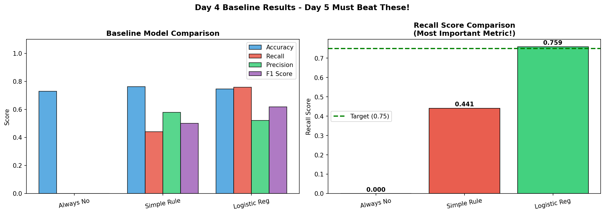

## Model Training and Comparison

Three classification algorithms were trained and evaluated:

1.  Logistic Regression
2.  Random Forest
3.  XGBoost

The project uses an 80:20 train-test split. The final model comparison
is based on the held-out test results shown in the model comparison
chart.

### Model performance

  -----------------------------------------------------------------------------
  Model            Accuracy    Precision       Recall     F1-score      ROC-AUC
  ------------ ------------ ------------ ------------ ------------ ------------
  Logistic            0.746        0.521    **0.759**        0.618        0.844
  Regression                                                       

  Random          **0.779**    **0.574**        0.717    **0.637**    **0.845**
  Forest                                                           

  XGBoost             0.767        0.555        0.701        0.619        0.838
  -----------------------------------------------------------------------------

### Selected model: Logistic Regression

Logistic Regression was selected because it achieved the highest recall
for the churn class:

-   **Accuracy:** 74.6%
-   **Precision:** 52.1%
-   **Recall:** 75.9%
-   **F1-score:** 61.8%
-   **ROC-AUC:** 84.4%

Random Forest achieved higher accuracy, precision, F1-score, and a
marginally higher ROC-AUC. However, Logistic Regression was selected
because the project prioritizes identifying as many actual churners as
possible.

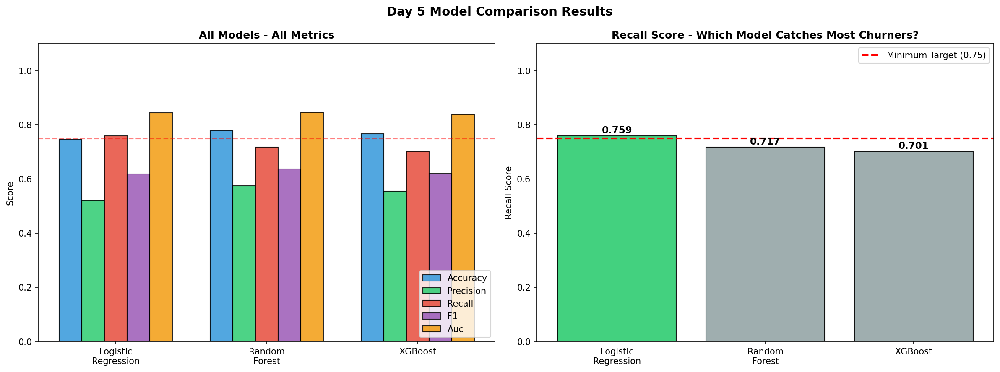

## Confusion Matrix and Error Analysis

The Logistic Regression confusion matrix on the test set contains:

  Outcome               Meaning                                    Count
  --------------------- ---------------------------------------- -------
  True Negative (TN)    Correctly predicted stayed                   762
  False Positive (FP)   Predicted churn, but customer stayed         266
  False Negative (FN)   Predicted stayed, but customer churned        92
  True Positive (TP)    Correctly predicted churned                  289

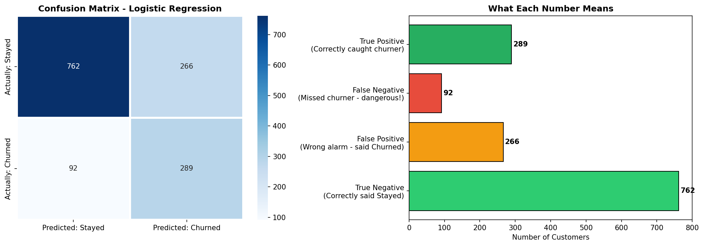

### What the errors mean

-   **False negatives:** 92 actual churners were missed by the model.
-   **False positives:** 266 customers were flagged as churners even
    though they stayed.
-   **True positives:** 289 churners were correctly identified.
-   **True negatives:** 762 customers who stayed were correctly
    identified.

The error-analysis chart further examines tenure among correctly
identified and missed churners, along with the distribution of predicted
churn probabilities.

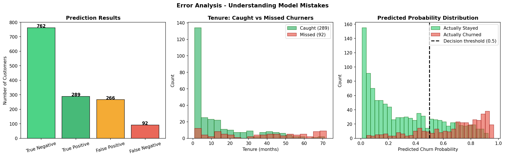

## Model Explainability with SHAP

SHAP (SHapley Additive exPlanations) was used to inspect how features
contribute to model predictions and to understand which features have
the greatest overall impact.

The supplied feature-importance chart ranks the leading features by mean
absolute SHAP value:

    Rank Feature                 Mean absolute SHAP value
  ------ --------------------- --------------------------
       1 `num_services`                            0.9807
       2 `tenure`                                  0.6553
       3 `MonthlyCharges`                          0.6390
       4 `charges_per_month`                       0.5052
       5 `TechSupport`                             0.3389
       6 `InternetService`                         0.3308
       7 `contract_risk`                           0.3135

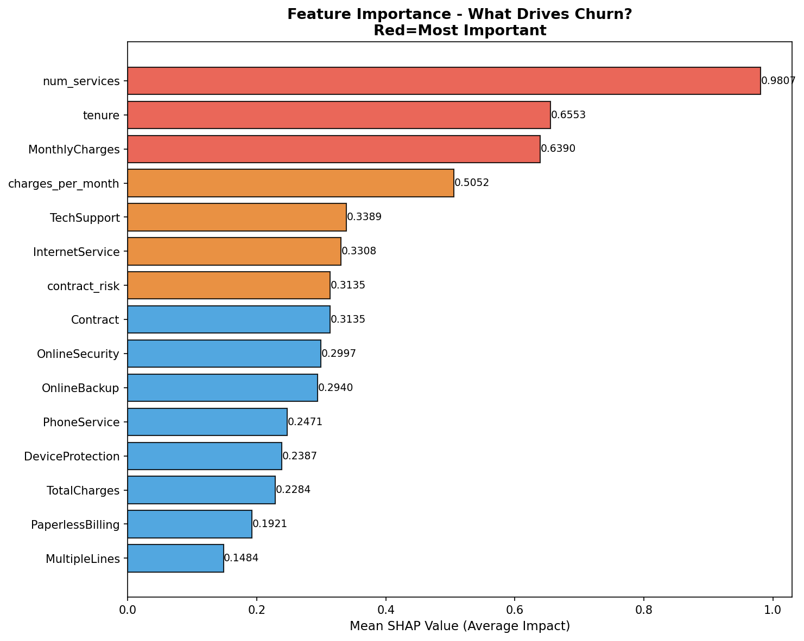

SHAP values describe how the trained model uses features to produce
predictions. They do not prove that a feature causes customer churn.

## Technology Stack

  Area                      Tools and libraries
  ------------------------- -----------------------
  Programming language      Python
  Data manipulation         Pandas, NumPy
  Machine learning          Scikit-learn, XGBoost
  Model explainability      SHAP
  Experiment tracking       MLflow
  Data visualization        Matplotlib, Seaborn
  Model persistence         Joblib
  Development environment   Jupyter Notebook

## Project Structure

The project setup script creates the following directory structure. The
exact notebook and generated-image filenames in your repository should
match the paths below, or the README image links should be adjusted to
match your actual filenames.

``` text
customer-churn-prediction/
│
├── data/
│   ├── raw/                         # Original dataset
│   └── processed/                   # Cleaned and engineered data
│
├── notebooks/
│   ├── 01_data_first_look.ipynb
│   ├── 02_deep_exploration.ipynb
│   ├── 03_feature_engineering.ipynb
│   ├── 04_baseline_model.ipynb
│   ├── 05_model_building.ipynb
│   └── 06_model_evaluation_fixed.ipynb
│
├── src/                             # Reusable Python modules
├── models/                          # Saved model artifacts
├── app/                             # Application/dashboard code
├── tests/                           # Tests
│
├── docs/
│   ├── churn_distribution.png
│   ├── churn_by_category.png
│   ├── churn_patterns.png
│   ├── charges_analysis.png
│   ├── numerical_distributions.png
│   ├── correlation_heatmap.png
│   ├── new_features_validation.png
│   ├── baseline_comparison.png
│   ├── model_comparison_chart.png
│   ├── confusion_matrix.png
│   ├── error_analysis.png
│   └── feature_importance_shap.png
│
├── requirements.txt
├── setup.py
└── README.md
```

## Installation and Usage

### 1. Clone the repository

``` bash
git clone https://github.com/YOUR-USERNAME/customer-churn-prediction.git
cd customer-churn-prediction
```

Replace `YOUR-USERNAME` and the repository name with your actual GitHub
details.

### 2. Create a virtual environment (recommended)

**Windows**

``` bash
python -m venv .venv
.venv\Scripts\activate
```

**macOS/Linux**

``` bash
python3 -m venv .venv
source .venv/bin/activate
```

### 3. Install dependencies

``` bash
pip install -r requirements.txt
```

### 4. Create the project folders

``` bash
python setup.py
```

### 5. Launch Jupyter Notebook

``` bash
jupyter notebook
```

Open the `notebooks/` directory and run the notebooks in sequence,
starting with `01_data_first_look.ipynb`.

> Run notebooks from the repository root so relative paths such as
> `data/raw/` and `docs/` resolve correctly.

The current supplied project files include the notebook workflow and
setup instructions. A runnable Streamlit dashboard entry point was not
provided, so a dashboard launch command is intentionally not included
here.

## Results Summary

-   Analyzed **7,043** telecom customer records.
-   Identified a churn proportion of **26.5%** in the dataset.
-   Created **7** additional customer features.
-   Compared baseline approaches and three machine learning classifiers.
-   Selected Logistic Regression based on churn recall of **75.9%**.
-   Used SHAP to interpret model feature importance.
-   Examined **92 false negatives** and **266 false positives** in the
    test set.

## Limitations

-   The dataset represents a particular telecom customer population;
    results may not generalize to other businesses.
-   The target is historical churn status. The current workflow does not
    validate a 30-day forecasting horizon.
-   The selected model's precision is 52.1%, so a substantial number of
    customers flagged as churners did not churn in the test set.
-   The model and preprocessing steps should be validated on new data
    before any real-world deployment.
-   SHAP feature importance indicates model influence, not causal
    relationships.
-   The supplied files do not include a complete deployed dashboard or
    production inference service.

## Future Improvements

-   Build and integrate an interactive Streamlit dashboard.
-   Package preprocessing and prediction into a reusable inference
    pipeline.
-   Tune the classification threshold based on the business cost of
    false positives and false negatives.
-   Validate the model using time-separated or newer customer data.
-   Add automated tests, model monitoring, and prediction logging.
-   Evaluate probability calibration and model performance across
    relevant customer groups.
-   Develop a properly time-aware forecasting setup if a 30-day-ahead
    churn prediction objective is required.

## Author

**Tanay Bera**\
B.Tech --- Artificial Intelligence and Machine Learning

-   **LinkedIn:** https://www.linkedin.com/in/tanay-bera-27211133a/
-   **GitHub:** Add your GitHub profile or repository link

------------------------------------------------------------------------

If you use or adapt this project, acknowledge the original dataset
provider and follow the dataset's terms of use.
