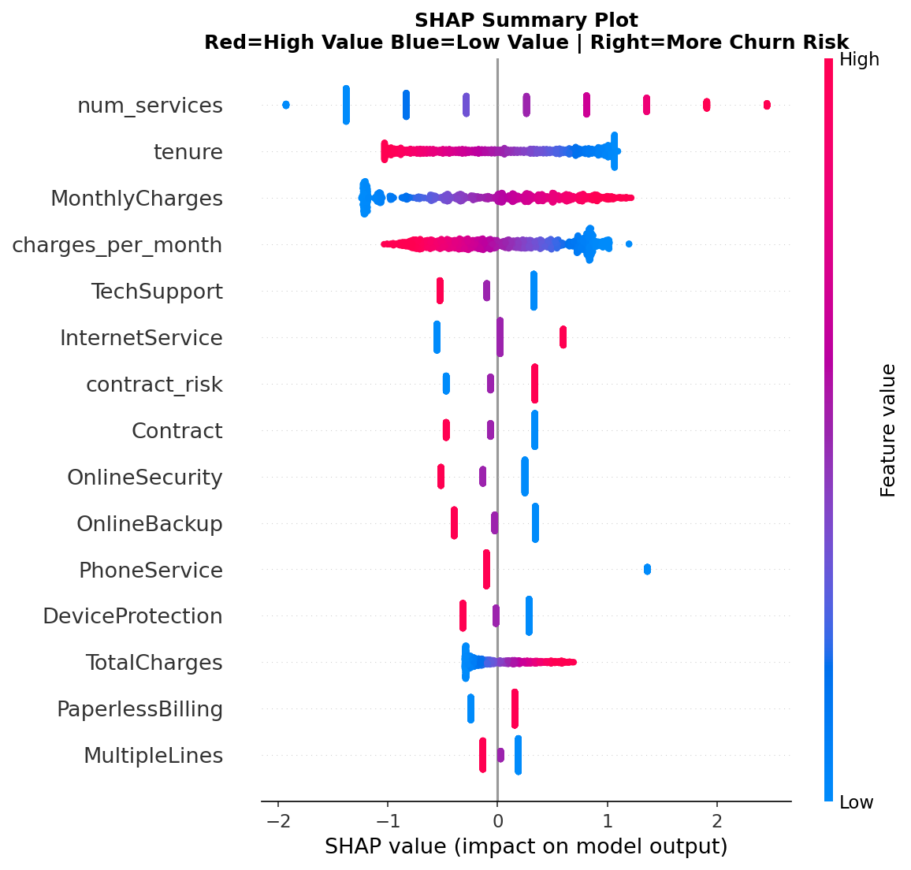

[README.md](https://github.com/user-attachments/files/34869996/README.md)
# Customer Churn Prediction

A machine learning project that analyzes customer behaviour and predicts whether a telecom customer is likely to leave the service. The project combines exploratory data analysis, feature engineering, classification models, model evaluation, and SHAP-based explainability.

## Project Overview

Customer churn is an important business problem for subscription-based companies. Identifying customers who are likely to leave can help businesses take proactive retention actions.

This project explores customer demographics, service subscriptions, contract details, tenure, and billing information to identify churn patterns and build predictive models.

## Objectives

- Explore customer data and identify patterns associated with churn.
- Engineer additional features to represent customer behaviour and contract risk.
- Train and compare Logistic Regression, Random Forest, and XGBoost classifiers.
- Prioritize recall because missing a customer who is likely to churn can result in a lost retention opportunity.
- Explain model predictions using SHAP.

## Dataset

The analysis uses a telecom customer churn dataset containing **7,043 customer records**.

| Churn status | Customers | Percentage |
|---|---:|---:|
| Stayed | 5,174 | 73.5% |
| Churned | 1,869 | 26.5% |
| **Total** | **7,043** | **100%** |

The dataset includes customer tenure, contract type, internet and support services, monthly charges, total charges, and churn status.

## Exploratory Data Analysis: Key Findings

- The overall churn rate is **26.5%**.
- Customers with a month-to-month contract have a churn rate of **42.7%**, compared with **11.3%** for one-year contracts and **2.8%** for two-year contracts.
- New customers with tenure of six months or less have a churn rate of **52.9%**, compared with **19.5%** for customers with tenure greater than six months.
- Churned customers have higher average monthly charges (**$74**) than customers who stayed (**$61**).
- The churn rate is highest among customers in the first six months (**53.3%**) and decreases across longer tenure groups.

These patterns suggest that early customer experience, contract type, and service engagement are important areas to investigate when designing retention strategies.

## Feature Engineering

Additional features were created to represent customer behaviour and contract risk:

| Feature | Description |
|---|---|
| `num_services` | Number of subscribed services |
| `charges_per_month` | Monthly charge relative to customer tenure/total charges, as implemented in the project |
| `is_new_customer` | Identifies customers with tenure of six months or less |
| `contract_risk` | Encodes contract type risk: two-year, one-year, and month-to-month |

*Use the same feature definitions and calculations as in the project notebook or source code.*

## Model Development and Evaluation

Three classification models were evaluated:

- Logistic Regression
- Random Forest
- XGBoost

Recall was treated as the primary business metric, with a minimum target of **0.75 (75%)**, because the project aims to identify as many actual churners as possible.

### Model comparison

| Model | Accuracy | Precision | Recall | F1-score | ROC-AUC |
|---|---:|---:|---:|---:|---:|
| Logistic Regression | 0.746 | 0.521 | **0.759** | 0.618 | 0.844 |
| Random Forest | **0.779** | **0.574** | 0.717 | **0.637** | **0.845** |
| XGBoost | 0.767 | 0.555 | 0.701 | 0.619 | 0.838 |

### Model comparison visualization


**Result:** Logistic Regression achieved the highest recall of **75.9%**, exceeding the 75% target. Random Forest achieved the highest accuracy (77.9%), precision (57.4%), F1-score (63.7%), and ROC-AUC (0.845).

The best model depends on the business objective. Logistic Regression is the choice when meeting the recall target is the priority; Random Forest performs best on several other reported metrics.

## Model Explainability with SHAP

SHAP (SHapley Additive exPlanations) was used to understand how input features influence model predictions.

The global feature-importance analysis highlights the following leading features:

1. `num_services`
2. `tenure`
3. `MonthlyCharges`
4. `charges_per_month`
5. `TechSupport`
6. `InternetService`

### SHAP summary plot



The SHAP summary plot shows both the importance of features and how high or low feature values influence the model output. Positive SHAP values move a prediction towards higher churn risk, while negative values move it towards lower churn risk.

## Technologies and Libraries

The project materials indicate the use of the following tools and libraries:

- Python
- Pandas and NumPy
- Scikit-learn
- XGBoost
- SHAP
- Matplotlib and Seaborn

## How to Run

1. Clone this repository:

   ```bash
   git clone <your-repository-url>
   cd <your-repository-folder>
   ```

2. Create and activate a virtual environment (optional but recommended):

   ```bash
   python -m venv venv
   ```

   Windows:

   ```bash
   venv\Scripts\activate
   ```

   macOS/Linux:

   ```bash
   source venv/bin/activate
   ```

3. Install the required packages:

   ```bash
   pip install pandas numpy scikit-learn xgboost shap matplotlib seaborn jupyter
   ```

4. Open and run the project notebook:

   ```bash
   jupyter notebook
   ```

   Run the notebook cells in order. If your project uses a `requirements.txt`, install from it instead:

   ```bash
   pip install -r requirements.txt
   ```

## Repository Structure

The following structure reflects the current GitHub repository:

```text
Customer-churn-prediction/
│
├── app/
│   └── dashboard.py
│
├── data/
│   ├── processed/
│   └── raw/
│
├── docs/                  # Project documentation and visualizations
│
├── models/
│   ├── churn_model.pkl
│   ├── feature_names.pkl
│   └── scaler.pkl
│
├── src/
│   ├── 01_data_first_look.ipynb
│   ├── 02_deep_exploration.ipynb
│   ├── 03_feature_engineering.ipynb
│   ├── 04_baseline_model.ipynb
│   └── 05_model_building.ipynb
│
├── LICENSE
├── README.md
├── requirements.txt
└── setup.py
```

- `app/` contains the dashboard application.
- `data/` separates raw and processed datasets.
- `docs/` contains the selected visualizations used in this README.
- `models/` stores the trained model and supporting preprocessing artifacts.
- `src/` contains the notebooks for data inspection, exploration, feature engineering, baseline evaluation, and model building.
- `requirements.txt` lists the Python dependencies, while `setup.py` contains the project setup configuration.

## Conclusion

This project demonstrates an end-to-end customer churn analysis and prediction workflow, from exploratory analysis and feature engineering to model comparison and explainability.

Logistic Regression achieved the target recall of **75.9%**, while Random Forest achieved the strongest overall results across accuracy, precision, F1-score, and ROC-AUC. SHAP analysis provides additional insight into the features influencing churn predictions.


---

*This README reports the metrics shown in the supplied model comparison results. Update repository paths and notebook filenames to match your final project structure.*
